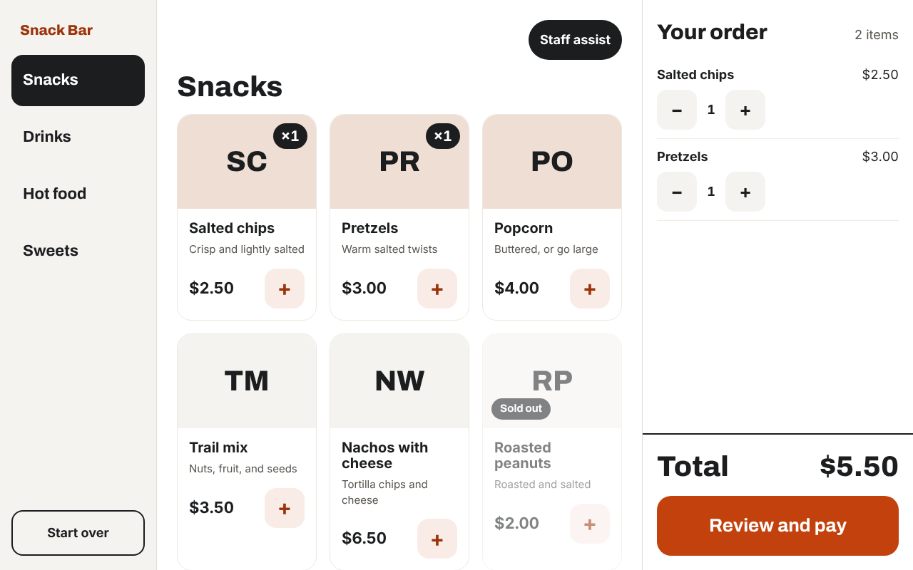
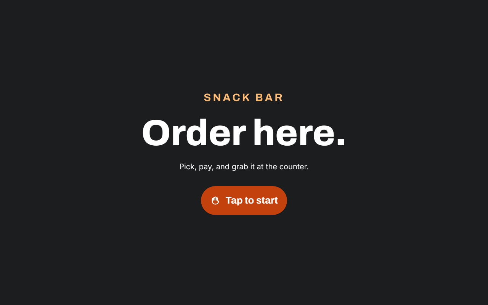
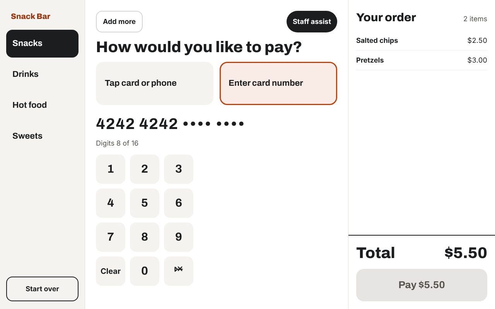
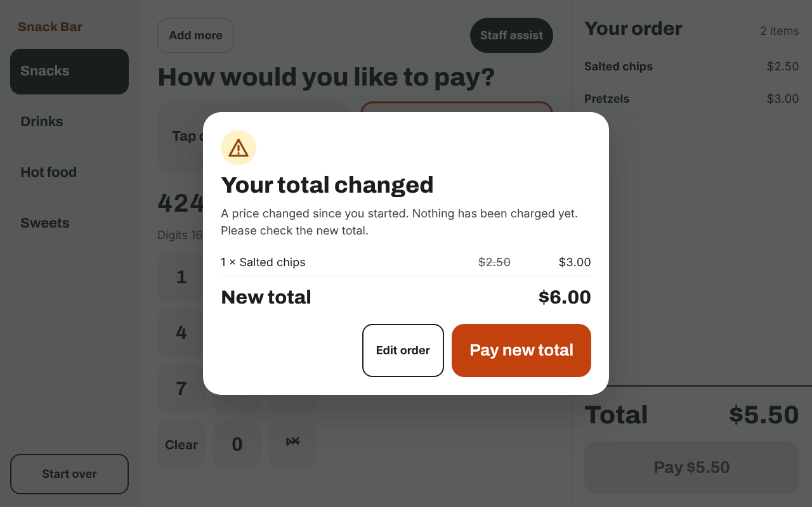
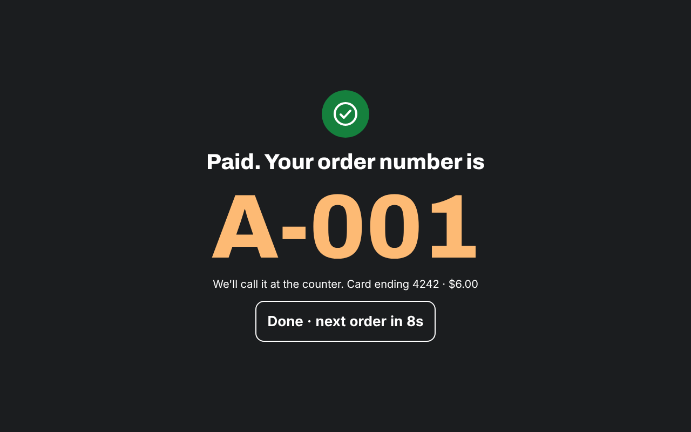
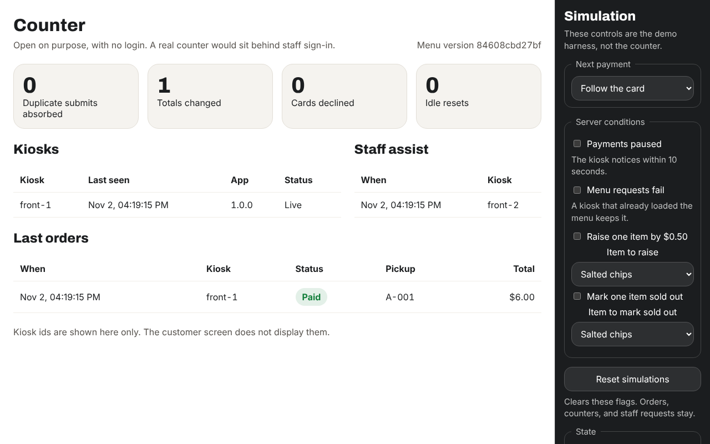

# Snack Bar Kiosk

The idea was to create an app simulating a self-service checkout for a snack-bar counter: a customer alone at a tablet browses the menu, orders, pays and leaves. I built it to explore what goes wrong when nobody is there to help.



## Run it

You need:

- Node 24 or 26 (`.nvmrc` is set to use Node 24)
- pnpm 11.1.3: `corepack enable` gives you the pinned version
- Docker with Compose v2 for the container path
- Chromium for Playwright for the browser tests: `pnpm exec playwright install chromium`

With Docker:

```bash
docker compose up --build
```

Open <http://localhost:8800>. If that port is taken:

```bash
WEB_PORT=8900 docker compose up --build
```

Without Docker:

```bash
pnpm install
```

```bash
pnpm dev
```

Open <http://localhost:5173>. `--host` is on, so a tablet on the same network can open `http://<your-ip>:5173`.

| What         | Docker                                                                                | Native                                                    |
| ------------ | ------------------------------------------------------------------------------------- | --------------------------------------------------------- |
| Kiosk        | <http://localhost:8800>                                                               | <http://localhost:5173>                                   |
| Counter page | <http://localhost:8800/ops>                                                           | <http://localhost:5173/ops>                               |
| API          | <http://localhost:8800/api> (nginx proxies `/api`; the API container isn't published) | <http://localhost:3000>, or `/api` through the Vite proxy |

Seed data: on first start the API loads `apps/api/seed/menu.json` (venue "Snack Bar", 4 categories, 21 items) into SQLite. It only inserts rows that don't exist yet, so editing the seed changes nothing on an existing database. To start from the seed again:

- with Docker: `docker compose down -v`
- natively: delete `apps/api/data/kiosk.db`

## Test it

```bash
pnpm verify
```

```bash
pnpm test:e2e
```

`pnpm verify` runs `biome check`, `tsc` in every package, and Vitest in every package. On 2026-11-02:

- `pnpm typecheck`: clean in all three packages.
- `pnpm test`: 108 passed (shared 37, API 34, web 37).
- `pnpm lint`: **1 error.** Biome wants single quotes in `apps/web/src/id.ts`. Until that's formatted, `pnpm verify` stops at lint. See [COVERAGE T6](docs/COVERAGE.md#traps-to-avoid-t).
- `pnpm test:e2e`: 18 passed in 48s. It starts its own API on 3010 and Vite on 5180, with a throwaway database at 1280×800 with touch.

## Try the failure cases

Payment is fake and deterministic. These test cards work at the numpad ("Enter card number"):

| Card number               | What you should see                                                                      |
| ------------------------- | ---------------------------------------------------------------------------------------- |
| `4242 4242 4242 4242`     | Approved. The done screen with a pickup number.                                          |
| `4000 0000 0000 0002`     | "Payment declined". The order is kept. A second decline offers "Get staff help".         |
| `4000 0000 0000 9995`     | Slow: "Processing payment…" for 15 seconds, then approved. Use it to reload mid-payment. |
| Tap ("Tap card or phone") | Approved.                                                                                |

Any other 16-digit number is approved.

**The `/ops` simulation rail.** Open `/ops` on a laptop and the kiosk on a tablet (or another tab). The flags live in memory. "Reset simulations", or a restart, clears them. The rail never presses buttons on the customer's screen.

| Rail control                                 | What you should see on the kiosk                                                                                                             |
| -------------------------------------------- | -------------------------------------------------------------------------------------------------------------------------------------------- |
| Next payment → "Declined"                    | The next payment, tap or card, is declined.                                                                                                  |
| Next payment → "No response, then approved"  | The payment is saved, then the connection drops. "Checking your payment…", then the done screen with the one order.                          |
| Next payment → "No response, never resolves" | "Checking your payment…" for 30 seconds, then "We couldn't confirm your payment" with a code for the counter.                                |
| Payments paused                              | Within 10 seconds: "We can't take payments right now. You can keep browsing." Pay is disabled. Untick it and Pay comes back by itself.       |
| Menu requests fail                           | A kiosk opened now shows "We're having trouble loading the menu" with a countdown and "Try now". A kiosk that already has the menu keeps it. |
| Raise one item by $0.50                      | Pay with that item in the cart: "Your total changed", the old and new price, "Pay new total" or "Edit order".                                |
| Mark one item sold out                       | The tile greys out with "Sold out". If it was already in a cart, paying names it and drops it.                                               |

**Environment flags** (API, off by default):

```bash
CHAOS_LATENCY_MS=800 CHAOS_FAIL_RATE=0.3 pnpm --filter @kiosk/api dev
```

- `CHAOS_LATENCY_MS`: extra delay on every request.
- `CHAOS_FAIL_RATE`: the fraction of `POST /orders` responses dropped after the order is saved (0 to 1). Retrying the same checkout returns that order. Menu and health stay up. A payment result chosen on the rail doesn't also roll this dice.

**URL flags**

- `?kiosk=front-1` sets the kiosk id. The default is `counter-1`.
- `?idle=5` shortens the idle wait to 5 seconds, for demos. The countdown after it stays at 10 seconds.

**The other cases**

- **Total changed:** use the rail's "+$0.50". Editing the seed and restarting doesn't work on an existing database (see Seed data above).
- **API down after the menu loaded:** `docker compose stop api`, or stop `pnpm dev`'s API. The kiosk keeps the cached menu and shows the payments banner. Start it again and the kiosk recovers within 10 seconds.
- **Reload mid-payment:** card `4000 0000 0000 9995`, Pay, reload within 15 seconds. You land on "Checking your payment…" and then the done screen, with one order on `/ops`.
- **Double tap:** tap Pay twice fast. One order; `/ops` counts the duplicate.

## What happens when…

Each line is the customer's side. The status, the tests and the reasoning are in [COVERAGE](docs/COVERAGE.md).

| ID                                                | The customer…                                         | The kiosk…                                                                                                                          |
| ------------------------------------------------- | ----------------------------------------------------- | ----------------------------------------------------------------------------------------------------------------------------------- |
| [H1](docs/COVERAGE.md#must-handle-h)              | taps Pay twice                                        | makes one order. The button locks, and the API dedupes on the `Idempotency-Key`.                                                    |
| [H2](docs/COVERAGE.md#must-handle-h)              | loses the network mid-payment                         | shows "Checking your payment…" and "Please don't pay again", asks the API about the same attempt, and never starts a second charge. |
| [H3](docs/COVERAGE.md#must-handle-h)              | arrives while the menu won't load                     | shows "We're having trouble loading the menu" and keeps retrying, with a "Try now" button.                                          |
| [H4](docs/COVERAGE.md#must-handle-h)              | pays after a price changed or an item sold out        | shows "Your total changed" with the difference before anything is charged.                                                          |
| [H5](docs/COVERAGE.md#must-handle-h)              | has a card declined                                   | sees "Payment declined", keeps the order, and can try again or use another card.                                                    |
| [H6](docs/COVERAGE.md#must-handle-h)              | walks away                                            | gets "Are you still there?" after 60 seconds, then the order is cleared for the next person.                                        |
| [H7](docs/COVERAGE.md#must-handle-h)              | has nothing in the cart, or keeps pressing +          | can't pay an empty cart. Quantity stops at 10.                                                                                      |
| [H8](docs/COVERAGE.md#must-handle-h)              | has paid                                              | sees a big pickup number, then the kiosk resets after 8 seconds.                                                                    |
| [H9](docs/COVERAGE.md#must-handle-h)              | is charged                                            | is charged the server's total, in integer cents.                                                                                    |
| [H10](docs/COVERAGE.md#must-handle-h)             | types a card number                                   | has only the last 4 digits kept.                                                                                                    |
| [K1](docs/COVERAGE.md#kiosk-specific-problems-k)  | reloads mid-payment                                   | lands back on "Checking your payment…" and gets the same order.                                                                     |
| [K2](docs/COVERAGE.md#kiosk-specific-problems-k)  | orders at one of several kiosks                       | gets a pickup number no other kiosk will get that day.                                                                              |
| [K3](docs/COVERAGE.md#kiosk-specific-problems-k)  | is ordering when the API goes down                    | can keep browsing. Pay waits until the API is back.                                                                                 |
| [K4](docs/COVERAGE.md#kiosk-specific-problems-k)  | is the next person at the screen                      | sees an empty order, never the last person's.                                                                                       |
| [K5](docs/COVERAGE.md#kiosk-specific-problems-k)  | orders at halftime with everyone else                 | waits on the venue's own API, not a cloud round trip. No load test yet.                                                             |
| [K6](docs/COVERAGE.md#kiosk-specific-problems-k)  | asks staff about their order                          | can be looked up from one log line by key, kiosk or order id.                                                                       |
| [K7](docs/COVERAGE.md#kiosk-specific-problems-k)  | races another kiosk for the last item                 | isn't protected. There's no stock count; staff mark items sold out.                                                                 |
| [K8](docs/COVERAGE.md#kiosk-specific-problems-k)  | relies on a screen reader or can't tell colours apart | gets labelled controls, a live total, and words next to every colour.                                                               |
| [K9](docs/COVERAGE.md#kiosk-specific-problems-k)  | needs a person                                        | taps "Staff assist". The counter sees it on `/ops`, and idle waits.                                                                 |
| [K10](docs/COVERAGE.md#kiosk-specific-problems-k) | looks at the screen                                   | sees the venue's name and colour, not mine.                                                                                         |
| [K11](docs/COVERAGE.md#kiosk-specific-problems-k) | is served by a counter that watches every kiosk       | shows staff, on `/ops`, recent orders, the counters, which kiosks are live, and who asked for help.                                 |
| [K12](docs/COVERAGE.md#kiosk-specific-problems-k) | waits on a payment that never answers                 | gets a code to show at the counter after 30 seconds, never a second charge.                                                         |
| [K13](docs/COVERAGE.md#kiosk-specific-problems-k) | wants to start over                                   | is asked to confirm when there's something in the cart.                                                                             |

## Coverage at a glance

| Group             | Items | Handled | Partial | Not handled: by choice | Not handled: out of time | Unverified |
| ----------------- | ----- | ------- | ------- | ---------------------- | ------------------------ | ---------- |
| Must handle (H)   | 10    | 10      | 0       | 0                      | 0                        | 0          |
| Should handle (S) | 6     | 4       | 2       | 0                      | 0                        | 0          |
| Traps (T)         | 9     | 5       | 4       | 0                      | 0                        | 0          |
| Kiosk (K)         | 13    | 9       | 3       | 1                      | 0                        | 0          |

The full matrix, with the evidence and the known gaps, is in [docs/COVERAGE.md](docs/COVERAGE.md).

## How it's built

```
apps/api         Fastify + better-sqlite3. Menu, orders, /ops. Runs its TypeScript directly on Node.
apps/web         Vite + React. The kiosk (one reducer drives every screen) and the /ops page.
packages/shared  Zod schemas for the menu, orders and /ops. Both apps import them; types are inferred.
e2e              Playwright, tablet viewport.
docs             Coverage, decisions, process, approach, the first mockup, screenshots.
```

**The contract.** `packages/shared` holds the schemas. A field changes there first, and both apps fail typecheck until they agree. Money is integer cents everywhere.

**Order states.** `pending_payment` → `paid` or `payment_failed`. The row is written as `pending_payment` before the payment call, and the outcome is written in a second transaction.

**Idempotency.** The kiosk makes one UUID per checkout attempt and sends it on every retry of that attempt. The API stores the key, a hash of the request and the final response on the order row, behind a unique index. The same key with the same request gets the stored response; with a different request it gets `422`.

The choices and what I rejected are in [docs/DECISIONS.md](docs/DECISIONS.md).

The endpoints and every status `POST /orders` can answer are in [docs/API.md](docs/API.md).

## How I approached and built it

The idea was to start from the person at the screen: what they'll do that a happy-path demo never shows, and the priorities we must avoid getting wrong for them. I designed every screen, including the recovery screens, as a clickable mockup before writing code. Then I built in phases with an AI coding agent under written rules, each phase ending in tests I ran myself.

- [docs/APPROACH.md](docs/APPROACH.md): how I thought about the problem, in order.
- [docs/PROCESS.md](docs/PROCESS.md): how I drove the tools, phase by phase: what I asked for, what I kept and what I threw away.
- [AGENTS.md](AGENTS.md): the rules the agent works under in this repo.

## Skipped and why

Each one on purpose, with where it would plug in.

- **Real payments.** The fake gateway in `apps/api/src/orders/payment.ts` is the seam. A real terminal would replace `createFakeGateway` and get our order id as its idempotency key ([D5](docs/DECISIONS.md#d5-the-idempotency-record-lives-on-the-order-and-the-order-is-written-before-the-payment-call)).
- **Auth.** There is none. Staff sign-in would sit in front of `/ops`, the simulation rail and the menu seed.
- **Admin and menu editing.** The menu is `apps/api/seed/menu.json` loaded into SQLite. An editor would write those rows; `menu.version` already changes when the contents change.
- **Multi-store.** One snack bar, one menu. A store id would join `kioskId` on the order and key the menu.
- **i18n.** English only. The copy is in the React screens, not a dictionary.
- **Receipts.** The done screen is the receipt. Email or print would hang off the paid order row.
- **Combos and multi-select modifiers.** Option groups with exactly one choice are in ([D7](docs/DECISIONS.md#d7-item-options-are-in-scope)). A combo is a second item type with its own line rules.
- **Tax.** Totals are the sum of line cents. Tax would be a second integer on the order, computed on the server next to `priceOrder`.
- **Offline order queueing.** The kiosk browses a cached menu offline but never takes a payment without the API ([D18](docs/DECISIONS.md#d18-a-cached-menu-but-no-offline-payments)). A queue would need a local journal with client-made ids and a terminal that can authorize offline.
- **Stock races.** Items have an `available` flag, not a count. A count would be a conditional decrement in the order's insert transaction, and the loser would get a 409 for that line ([D19](docs/DECISIONS.md#d19-stock-races-are-deferred)).
- **Reconciling a payment that never answered.** The customer gets a code and the row stays `pending_payment`. A staff action on `/ops` would settle it ([COVERAGE K12](docs/COVERAGE.md#kiosk-specific-problems-k)).
- **Deployment.** Docker Compose is the run path. No cloud, no CI deploy, no TLS.
- **A screen recording of the failure cases.** The screenshots below and the `/ops` rail stand in for it.
- **Tests I cut:** a portrait Playwright project, an axe run in the suite, and a Playwright reload mid-payment. The features are there; the reload is covered by a reducer test and was checked by hand ([COVERAGE S1, S2, K1](docs/COVERAGE.md)).

## Screenshots

Captured with Playwright at 1280×800 on 2026-11-02, from the compose stack on a fresh database.

|                                                                                                  |                                                                                                                     |
| ------------------------------------------------------------------------------------------------ | ------------------------------------------------------------------------------------------------------------------- |
|             |                                           |
| Attract                                                                                          | Menu with a cart                                                                                                    |
|  |  |
| Pay, card numpad                                                                                 | Recovery: the total changed                                                                                         |
|                       |       |
| Done                                                                                             | `/ops`                                                                                                              |

Portrait, 800×1280: [docs/screenshots/portrait-menu.png](docs/screenshots/portrait-menu.png).
